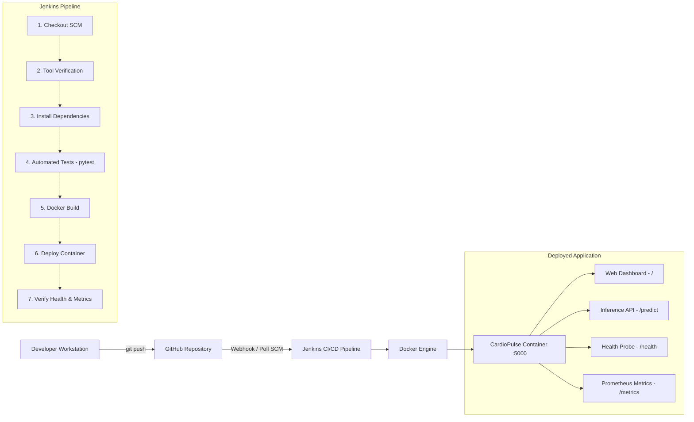

# CardioPulse: Heart Disease Risk Prediction & Monitoring System

[](https://jenkins.io)
[](https://www.python.org/)
[](https://flask.palletsprojects.com/)
[](https://scikit-learn.org/)
[](https://prometheus.io/)

> **Student**: Pratham Kadam (Roll: DS 14, PRN: 2324000362)  
> **Course**: ML DevOps Laboratory (UAMPC0732)  
> **Class**: Final Year B. Tech - CSE (Data Science), Semester - VII  
> **Evaluation**: ISE - 2 (10 Marks)  
> **Use Case**: End-to-End MLOps Application with CI/CD Pipeline & Monitoring  
> **Repository**: [https://github.com/prathham-k21/mldevops-cicd](https://github.com/prathham-k21/mldevops-cicd)

---

## 📌 1. Project Overview

**CardioPulse** is an end-to-end Machine Learning web application designed to predict the likelihood of cardiovascular disease in patients using key clinical biomarkers (age, blood pressure, cholesterol, resting ECG, maximum heart rate, etc.).

This project demonstrates the complete **MLOps & DevOps lifecycle on Windows OS**, including:
1. **Model Development & Training**: Scikit-Learn Random Forest Classifier evaluated with train-test splits and classification metrics.
2. **Web Application & REST API**: Flask serving both a responsive medical UI and programmatic `/predict` endpoint.
3. **Automated Testing**: Comprehensive unit tests with `pytest` ensuring API reliability, error handling, and inference sanity.
4. **Application Containerization**: Dockerfile for reproducible packaging and deployment.
5. **Continuous Integration & Deployment (CI/CD)**: Declarative `Jenkinsfile` automating checkout, environment verification, testing, docker build, and deployment.
6. **Telemetry & Monitoring**: Integrated Prometheus metrics endpoint (`/metrics`) exposing request counts, latency histograms, and prediction distributions alongside a `/health` probe.

---

## 🏗️ 2. System Architecture



---

## 🛠️ 3. Tools & Environment Setup

| Tool | Purpose | Version Used |
| :--- | :--- | :--- |
| **Python & Flask** | Machine Learning modeling & Web Service | Python 3.13 / Flask 3.1.3 |
| **Scikit-Learn** | ML training, Random Forest Classifier | 1.7.2 |
| **Git** | Distributed Version Control | Git 2.47.1 |
| **GitHub** | Cloud Source-Code Hosting | GitHub Remote |
| **Docker** | Containerization & Runtime Environment | Docker 29.4.3 |
| **Jenkins** | CI/CD Automation & Build Orchestration | Jenkins LTS / Java 23 |
| **Prometheus Client** | Inference & Latency Monitoring | 0.21.0 |
| **Pytest** | Automated Unit & Integration Testing | 9.0.3 |

---

## 🚀 4. Step-by-Step Execution Guide (Windows Commands)

### Step 1: Clone Repository & Setup Environment
```powershell
# Check Python and Git versions
python --version
pip --version
git --version

# Install dependencies
pip install -r requirements.txt
```

### Step 2: Train Machine Learning Model
```powershell
python train.py
```
*Output*: Generates serialized model artifact in `model/heart_disease_model.joblib` with ~88-90% validation accuracy.

### Step 3: Run Automated Unit Tests
```powershell
python -m pytest -v
```

### Step 4: Run Flask Web Application Locally
```powershell
python app.py
```
* Access Web UI: [http://localhost:5000](http://localhost:5000)
* Health Status: [http://localhost:5000/health](http://localhost:5000/health)
* Prometheus Metrics: [http://localhost:5000/metrics](http://localhost:5000/metrics)

### Step 5: Test Prediction via REST API
```powershell
curl -X POST http://localhost:5000/predict `
  -H "Content-Type: application/json" `
  -d '{"age": 60, "sex": 1, "cp": 0, "trestbps": 150, "chol": 270, "fbs": 0, "restecg": 1, "thalach": 120, "exang": 1, "oldpeak": 2.5}'
```

### Step 6: Docker Containerization
```powershell
# Verify Docker
docker --version
docker info

# Build Docker Image
docker build -t cardiopulse-ml-app .

# Run Container
docker run -d -p 5000:5000 --name cardiopulse-service cardiopulse-ml-app

# Check Running Container
docker ps
```

### Step 7: Jenkins CI/CD Setup
1. Open Jenkins at `http://localhost:8080`.
2. Create a new **Pipeline** project named `CardioPulse-CI-CD`.
3. Under **Build Triggers**, select **GitHub hook trigger for GITScm polling** or **Poll SCM**.
4. Under **Pipeline Definition**, select **Pipeline script from SCM**, choose **Git**, and provide your repository URL.
5. Set Script Path to `Jenkinsfile`.
6. Click **Build Now** to execute the pipeline.

---

## 📊 5. Monitoring & Observability

CardioPulse includes built-in Prometheus metrics exposed at `/metrics`:
- `http_requests_total{endpoint, method, status}`: Monitors incoming traffic volume and HTTP status codes.
- `http_request_duration_seconds{endpoint}`: Histogram tracking latency of ML inference requests.
- `model_predictions_total{risk_category}`: Tracks real-time ratio between High Risk vs Low Risk predictions to detect data and prediction drift.

